Vega Seek Bar Sample App
========================

The Vega Seek Bar Sample App demonstrates how to implement advanced seek bar functionality for TV apps with comprehensive examples and TV-optimized interactions.

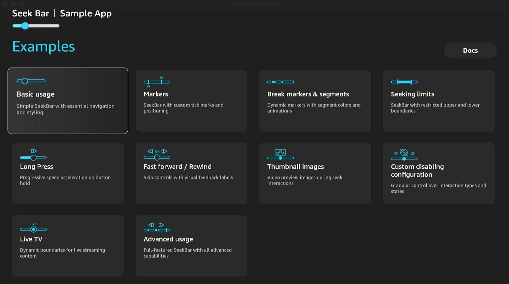

Introduction
------------

**Key features**

- Basic playback controls for tracking video progress.
- Advanced seek bar features with trickplay images, Live TV support, and dynamic seeking limits.
- Seeking controls for fast forward, rewind, and long press.
- Visual markers for advertising and video segments.
- Optimized TV remote control navigation for seeking.
- Custom disabling configurations.
- Speed acceleration and skip controls.

**Note**: Although this app contains recommendations, you can take different approaches to building components, screens, or using libraries. This guide serves as a starting point, but we encourage you to explore and adopt best practices that suit your specific project requirements.

**Compatibility**

| Dependency | Version |
|---|---|
| React Native | 0.83.0 |
| React | 19.2.0 |
| Kepler UI Components | 3.1.0+ |
| React Native Kepler | 4.0.0 |
| React Navigation | 8.0.x |
| Node.js | 22.14+ |
| Vega SDK | 2.0+ |
| Vega OS | 2.0+ |


Build and run the app
---------------------

### Prerequisites

Before you launch the sample app, make sure that you have:

* [Vega Developer Tools](https://developer.amazon.com/docs/vega/latest/install-vega-sdk.html) (Vega SDK 2.0+)
* [Python v3.x](https://www.python.org/downloads/)
* [Java Runtime Environment v21 or later](https://learn.microsoft.com/en-us/java/openjdk/download)
* [NodeJS v22.14 or later](https://nodejs.org/en/download/)

**Note**: Building this app requires Vega SDK 2.0 or later. The app targets Vega OS 2.0 (`min` and `target` in the `[os.version]` section of `manifest.toml`). To support OS 1.2 devices, you can set `min = "1.2"`, but then guard any API added after OS 1.2. See [Target OS versions](https://developer.amazon.com/docs/vega/latest/target-os-version.html).

### Step 1: Build the app

After you download the source code from GitHub, you can build the Vega Seek Bar Sample App from the command line to generate VPKG files. The VPKG files run on the Vega Virtual Device and Vega OS Fire TV Stick.

You can also use [Vega Studio](https://developer.amazon.com/docs/vega/latest/setup-extension.html) with Visual Studio Code to build the app.

1. At the command prompt, navigate to the Vega Seek Bar Sample App source code directory. 

2. To install the app dependencies, run the following command. The installation can take several minutes to complete.

   ```
   npm install
   ```

3. To build the app to generate .vpkg files, run the following command.

   ```
   npm run build:app
   ```

4. At the command prompt, in the **build** folder, verify that you generated the VPKG files for your device's architecture.

   - **armv7-release/vegaseekbarapp_armv7.vpkg**&mdash;generated on x86_64 and Mac M-series devices to run on the Vega OS Fire TV Stick.
   - **x86_64-release/vegaseekbarapp_x86_64.vpkg**&mdash;generated on an x86_64 device to run on the VVD.
   - **aarch64-release/vegaseekbarapp_aarch64.vpkg**&mdash;generated on a Mac M-series device to run on the VVD.

### Step 2: Run the app

#### Vega Virtual Device

1. To start the Vega Virtual Device, at the command prompt, run the following command.

   ```
   vega virtual-device start
   ```

2. To install and launch the app on the Vega Virtual Device, run the following command, depending on your device architecture.

   - On Mac M-series-based devices.

     ```
     vega run-app build/aarch64-release/vegaseekbarapp_aarch64.vpkg
     ```

   - On x86_64-based devices.
     ```
     vega run-app build/x86_64-release/vegaseekbarapp_x86_64.vpkg
     ```

#### Vega OS Fire TV Stick

1. Turn on your Vega OS Fire TV Stick.

2. To install and launch the app on your Vega OS Fire TV Stick, run the following command.

   ```
   vega run-app build/armv7-release/vegaseekbarapp_armv7.vpkg
   ```

Seek bar examples
-----------------

The app includes comprehensive seek bar examples accessible from the home screen. Each example corresponds to a complete implementation in the `src/screens` folder, providing ready-to-use code snippets that you can integrate into your own apps.

- **[Basic usage](./src/screens/BasicUsage.tsx)**&mdash;Simple SeekBar with essential navigation and styling, demonstrating fundamental implementation with custom thumb icons and TV-optimized focus management. 

  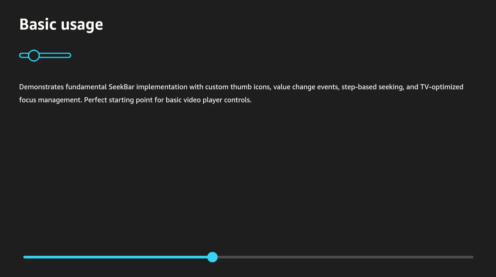


- **[Markers](./src/screens/WithMarkers.tsx)**&mdash;SeekBar with custom tick marks and positioning, showing how to add visual markers and arrow indicators for precise positioning.

  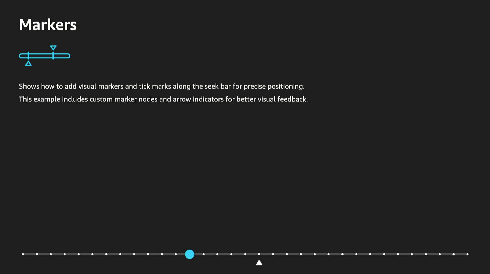


- **[Break Markers & Segments](./src/screens/BreakMarkers.tsx)**&mdash;Advanced marker system with break points, segment coloring, and smooth animations for content with ad breaks or chapters.

  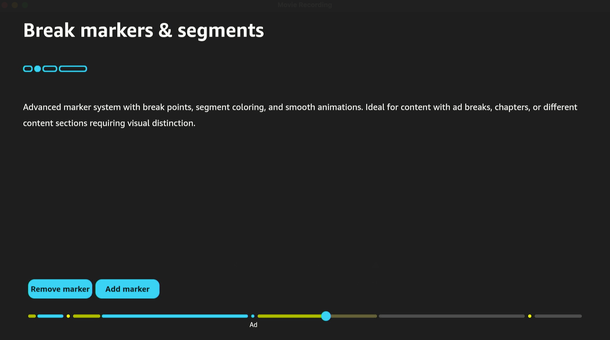


- **[Seeking Limits](./src/screens/Limits.tsx)**&mdash;SeekBar with restricted upper and lower limits to restrict user navigation within specific time ranges.

  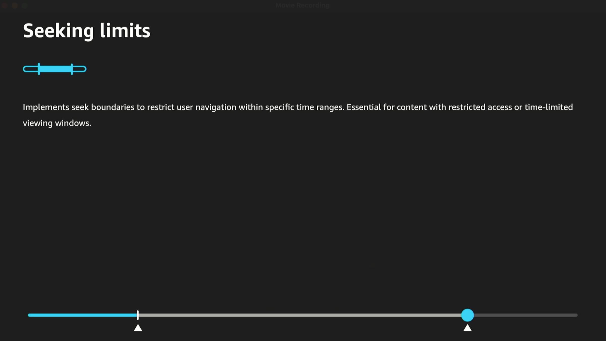


- **[Long Press](./src/screens/LongPress.tsx)**&mdash;Progressive speed acceleration on button hold using D-pad buttons with configurable acceleration intervals and multipliers.

  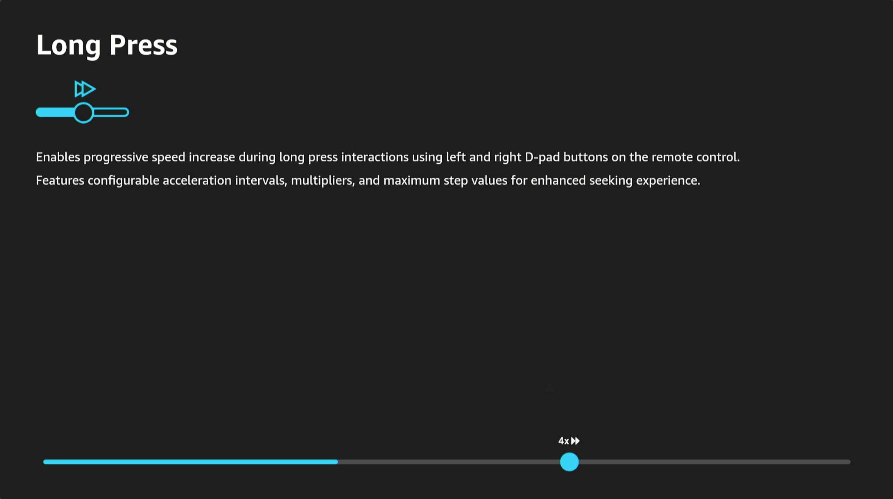


- **[Fast Forward / Rewind](./src/screens/FastForwardRewind.tsx)**&mdash;Skip controls with visual feedback labels implementing fast forward and rewind functionality with speed indicators.

  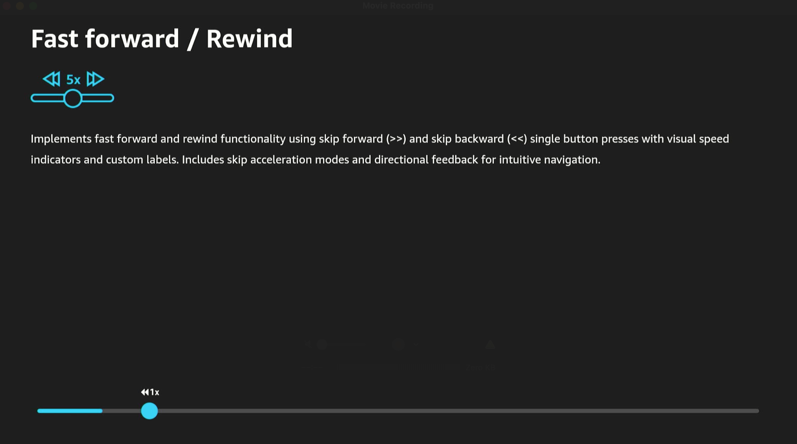


- **[Thumbnail Images](./src/screens/Thumbnail.tsx)**&mdash;Video preview images during seek interactions with custom labels and formatting for enhanced user experience.

  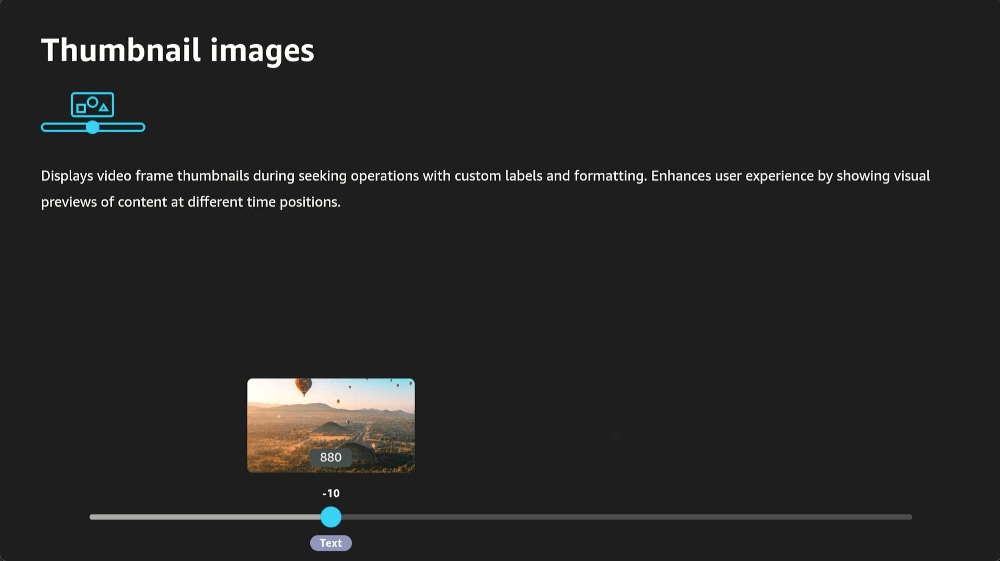


- **[Custom Disabling Configuration](./src/screens/CustomDisablingConfig.tsx)**&mdash;Granular control over interaction types and states with selective enabling/disabling of controls based on focus state.

  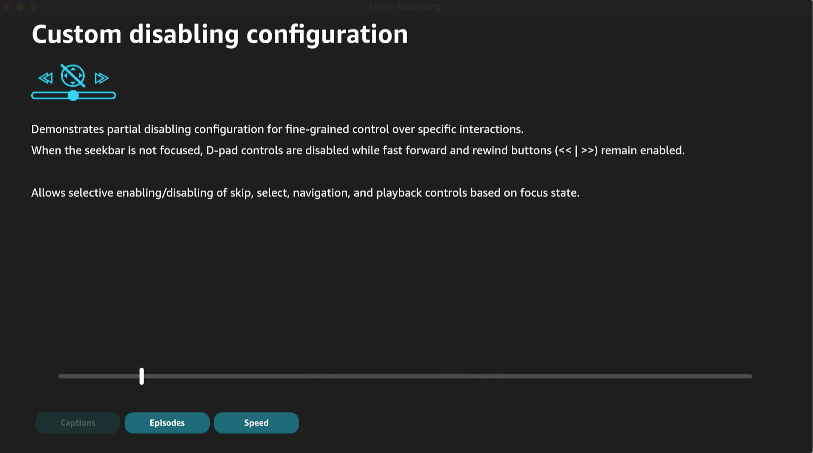


- **[Live TV](./src/screens/LiveTV.tsx)**&mdash;Dynamic limits for live streaming content with real-time updates and live point indicators.

  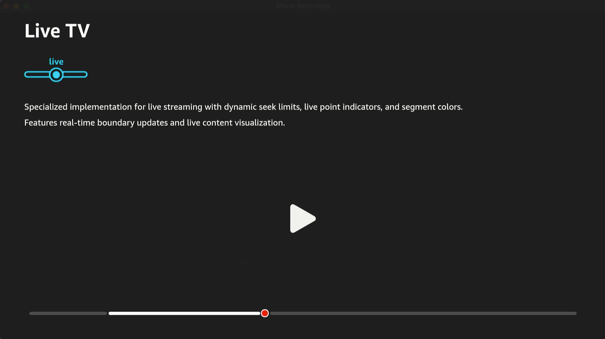


- **[Advanced Usage](./src/screens/ComplexUsage.tsx)**&mdash;Comprehensive example showcasing all SeekBar features including thumbnails, markers, animations, and complete event handling.

  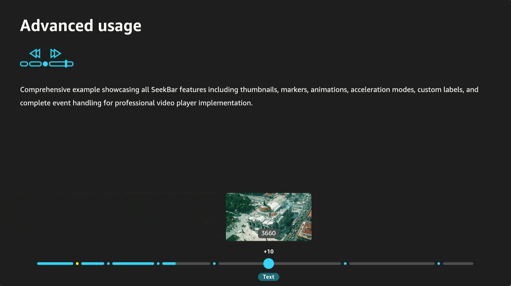

Troubleshooting the app
-----------------------

If you encounter unexpected issues when you build and run the app (for example, the build fails randomly, the app doesn't start, or the app crashes randomly), try the following solutions:

1. To remove the **node_modules** folder, the **package-lock.json** file and other files related to your previous builds, run the following command. 

   ```
   npm run clean
   ```

2. To clear the cache when you work in debug mode, run the following command. 
   
   ```
   npm run start -- --reset-cache
   ```

## Credits and attribution

All screenshots, images, and icons in the **./docs/images/**, **./src/assets/** directories were created internally by Amazon and are included under the same license as this project.


License
-------

See [LICENSE](LICENSE.txt) file.

Release notes
-------------

### v2.0

- Targets Vega OS 2.0 and requires Vega SDK 2.0.
- Updated the `@amazon-devices/*` dependency ranges for OS 2.0.

### v0.24

Migrated to React Native 0.83 and Vega SDK 0.24.

**Platform Updates**

- **React Native 0.83**&mdash;Upgraded from 0.72 with React 19, new Yoga layout engine, and updated TV focus system.
- **React Navigation 8**&mdash;Upgraded from v7, with React Native Screens v3.
- **Kepler UI Components 3.1**&mdash;Upgraded from v2, with updated SeekBar API.
- **Node.js 22.14+**&mdash;Required by the new toolchain (previously v18-v20).
- **Build command**&mdash;`build-kepler` replaced by `build-vega`.

**Migration Notes**

- `Pressable` from `@amazon-devices/react-native-kepler` now requires `disabled !== true` to be focusable. Components using `partialDisablingConfiguration` with `select: !focused` should be reviewed.
- `TouchableOpacity` requires `onPress` (or `onPressIn`/`onPressOut`) to participate in TV focus traversal.
- Default `borderColor` is now `'black'` instead of transparent&mdash;add explicit `borderColor: 'transparent'` where borders are used only for focus state styling.
- `react-linear-gradient` replaced by native `experimental_backgroundImage` style prop.

### v0.21

Welcome to the first release of the Vega Seek Bar Sample App! This sample app provides you with everything needed to implement professional-grade seek bar functionality in Fire TV apps.

**Core Features**

- **10 Complete Seek Bar Examples**&mdash;From basic usage to advanced implementations with live TV support.
- **TV-First Design**&mdash;Built specifically for Fire TV with optimized remote control interactions and focus management.
- **Production-Ready Components**&mdash;Professional seek bar implementations ready for integration into your apps.

**Example Library**

- **Basic Usage**&mdash;Basic seek bar with essential controls.
- **Visual Markers**&mdash;Custom tick marks and positioning indicators.
- **Break Markers & Segments**&mdash;Advanced marker system with animations and segment coloring.
- **Seeking Limits**&mdash;Limit restrictions for controlled navigation.
- **Long Press Controls**&mdash;Progressive speed acceleration with configurable intervals.
- **Fast Forward/Rewind**&mdash;Skip functionality with visual feedback.
- **Thumbnail Previews**&mdash;Video frame thumbnails during seeking.
- **Custom Disabling**&mdash;Detailed control over interaction states.
- **Live TV Support**&mdash;Dynamic limits for streaming content.
- **Advanced Integration**&mdash;Complete feature showcase with professional implementation control over interaction states.
